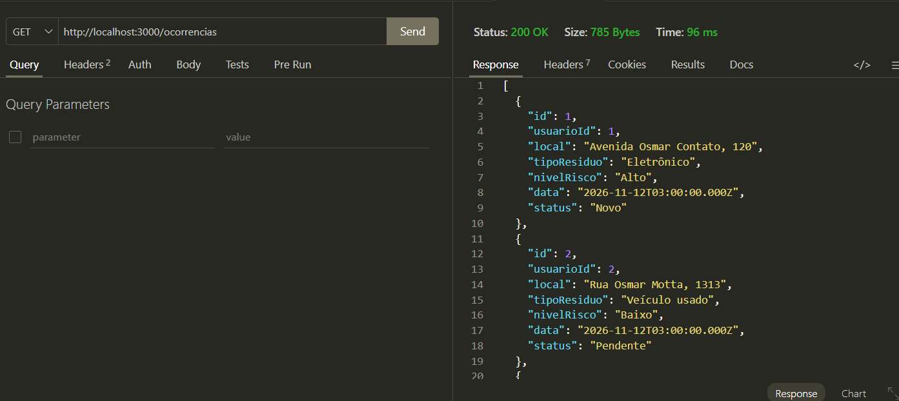
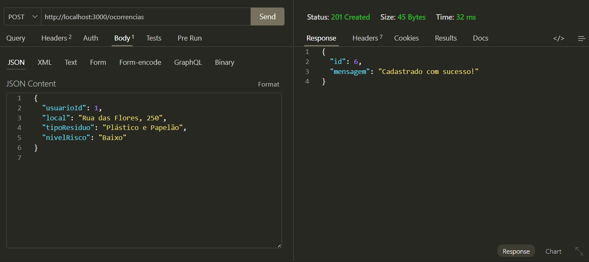
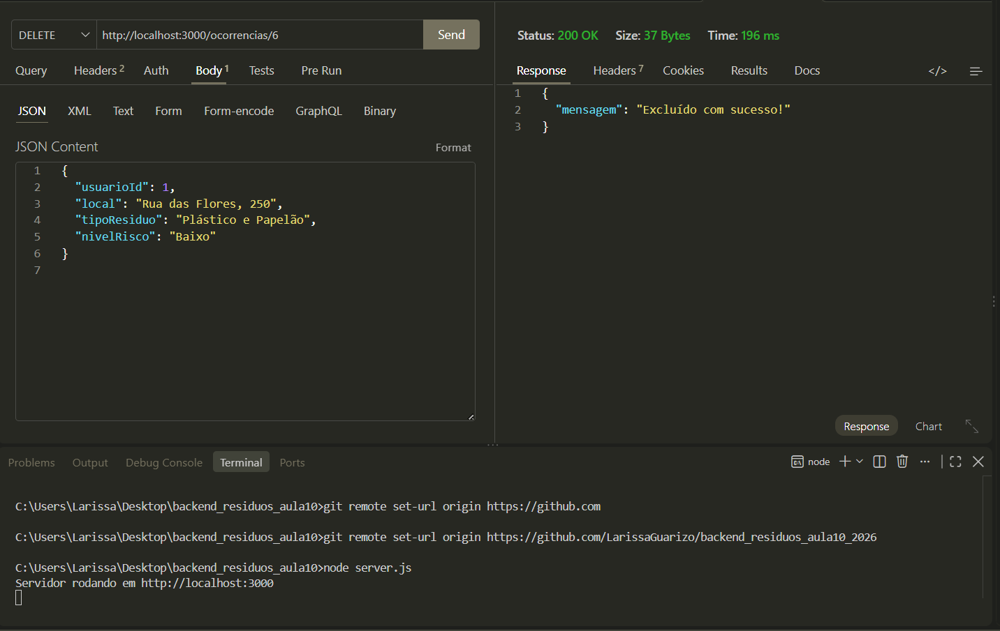

# Gestão de Resíduos Sólidos

## Descrição
Aplicação web Full Stack desenvolvida para o gerenciamento e monitoramento de ocorrências de descarte de resíduos. O sistema permite cadastrar usuários e registrar ocorrências informando o local, tipo de resíduo, nível de risco (`Baixo`, `Medio`, `Alto`), data e status de atendimento (`Novo`, `Pendente`, `Tratado`), integrando uma interface HTML/JavaScript a uma API REST em Node.js e banco de dados MySQL.

---

## Tecnologias
- HTML
- CSS
- JS
- Node.js
- Express
- Cors
-  MySQL / MariaDB (via XAMPP / phpMyAdmin)
-  mysql2
-  Thunder Client

## Passo a passo para testar o projeto
### 1. Pré-requisitos
Certifique-se de ter instalado em sua máquina:
* Node.js
* XAMPP
* Insomnia

### 2. Configurar o Banco de Dados
1. Inicie o módulo MySQL no painel do XAMPP.
2. Acesse o phpMyAdmin (`http://localhost/phpmyadmin`).
3. Abra o arquivo `docs/script.sql` deste repositório, copie o conteúdo e execute na aba SQL para criar o banco `gestao_residuos` e popular as tabelas iniciais.

### 3. Instalar Dependências e Rodar o Servidor
1. Clone este repositório ou baixe os arquivos:
   ```bash
   git clone https://github.com
   ```
2. Acesse a pasta do projeto pelo terminal e instale os pacotes:
   ```bash
   npm install
   ```
3. Verifique as credenciais do banco no arquivo `src/config/db.js` (`host`, `user`, `password` e `database`).
4. Inicie o servidor:
   ```bash
   node server.js
   ```
5. Acesse a interface web no navegador em `http://localhost:3000`.

## Prints

- Listar


- Cadastrar


- Excluir
