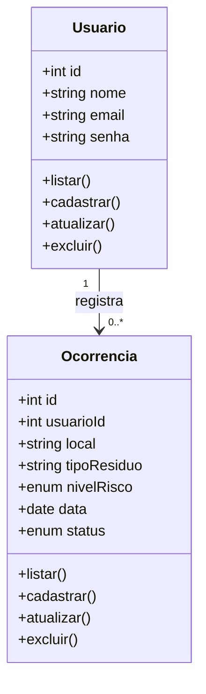

# Gestão de Resíduos Sólidos

## Descrição
Aplicação web Full Stack desenvolvida para o gerenciamento e monitoramento de ocorrências de descarte de resíduos. O sistema permite cadastrar usuários e registrar ocorrências informando o local, tipo de resíduo, nível de risco (`Baixo`, `Medio`, `Alto`), data e status de atendimento (`Novo`, `Pendente`, `Tratado`), integrando uma interface HTML/JavaScript a uma API REST em Node.js e banco de dados MySQL.

---

## 📊 Diagrama de Classes



---

## 🛠️ Tecnologias Utilizadas
* **Front-end:** HTML5, CSS3, JavaScript (Fetch API)
* **Back-end:** Node.js, Express, CORS
* **Banco de Dados:** MySQL / MariaDB (via XAMPP / phpMyAdmin)
* **Driver de Conexão:** `mysql2`
* **Testes de API:** Insomnia / Postman / Thunder Client

---

## 🚀 Passo a Passo para Testar o Projeto

### 1. Pré-requisitos
Certifique-se de ter instalado em sua máquina:
* [Node.js](https://nodejs.org)
* [XAMPP](https://apachefriends.org) (ou MySQL Server)
* [Insomnia](https://insomnia.rest) ou [Postman](https://postman.com)

### 2. Configurar o Banco de Dados
1. Inicie o módulo **MySQL** no painel do XAMPP.
2. Acesse o **phpMyAdmin** (`http://localhost/phpmyadmin`).
3. Abra o arquivo `docs/script.sql` deste repositório, copie o conteúdo e execute na aba **SQL** para criar o banco `gestao_residuos` e popular as tabelas iniciais.

### 3. Instalar Dependências e Rodar o Servidor
1. Clone este repositório ou baixe os arquivos:
   ```bash
   git clone https://github.com
   ```
2. Acesse a pasta do projeto pelo terminal e instale os pacotes:
   ```bash
   npm install
   ```
3. Verifique as credenciais do banco no arquivo `src/config/db.js` (`host`, `user`, `password` e `database`).
4. Inicie o servidor:
   ```bash
   node server.js
   ```
5. Acesse a interface web no navegador em **`http://localhost:3000`**.

---

## 🧪 Prints dos Testes da API (Insomnia / Postman)

### 1. Listar Ocorrências (`GET /ocorrencias`)
> *Retorna todas as ocorrências cadastradas no banco de dados.*


---

### 2. Cadastrar Nova Ocorrência (`POST /ocorrencias`)
> *Envia um JSON no corpo da requisição para registrar um novo resíduo.*

**Exemplo de JSON enviado:**
```json
{
  "usuarioId": 1,
  "local": "Rua das Flores, 250",
  "tipoResiduo": "Eletrônico",
  "nivelRisco": "Alto"
}
```


---

### 3. Atualizar Ocorrência (`PUT /ocorrencias/:id`)
> *Atualiza os dados ou o status de uma ocorrência existente.*

**Exemplo de JSON enviado:**
```json
{
  "local": "Rua das Flores, 250",
  "tipoResiduo": "Eletrônico",
  "nivelRisco": "Alto",
  "status": "Tratado"
}
```


---

### 4. Excluir Ocorrência (`DELETE /ocorrencias/:id`)
> *Remove uma ocorrência pelo seu ID.*


Use o código com cuidado.

Como colocar os seus prints no README

Para que as imagens apareçam no GitHub sem quebrar:
1. Crie uma pasta chamada prints dentro da sua pasta docs (docs/prints/).
2. Tire os prints das telas do Insomnia/Postman testando cada rota (GET, POST, PUT, DELETE) e salve dentro dessa pasta com os nomes:
	• get-ocorrencias.png
	• post-ocorrencias.png
	• put-ocorrencias.png
	• delete-ocorrencias.png
3. Suba tudo para o GitHub usando git add ., git commit -m "Adiciona README" e git push.
Você quer que eu adicione também os exemplos e espaços de print para as rotas de Usuários (/usuarios) no README, ou vai entregar apenas com os testes de Ocorrências?


## Tecnologias
- HTML
- CSS
- JS
- Node.js
- Express
- Cors
-  MySQL / MariaDB (via XAMPP / phpMyAdmin)
-  mysql2
-  Thunder Client

## Passo a passo para testar o projeto
### 1. Pré-requisitos
Certifique-se de ter instalado em sua máquina:
* [Node.js](https://nodejs.org)
* [XAMPP](https://apachefriends.org) (ou MySQL Server)
* [Insomnia](https://insomnia.rest) ou [Postman](https://postman.com)

### 2. Configurar o Banco de Dados
1. Inicie o módulo **MySQL** no painel do XAMPP.
2. Acesse o **phpMyAdmin** (`http://localhost/phpmyadmin`).
3. Abra o arquivo `docs/script.sql` deste repositório, copie o conteúdo e execute na aba **SQL** para criar o banco `gestao_residuos` e popular as tabelas iniciais.

### 3. Instalar Dependências e Rodar o Servidor
1. Clone este repositório ou baixe os arquivos:
   ```bash
   git clone https://github.com
   ```
2. Acesse a pasta do projeto pelo terminal e instale os pacotes:
   ```bash
   npm install
   ```
3. Verifique as credenciais do banco no arquivo `src/config/db.js` (`host`, `user`, `password` e `database`).
4. Inicie o servidor:
   ```bash
   node server.js
   ```
5. Acesse a interface web no navegador em **`http://localhost:3000`**.
